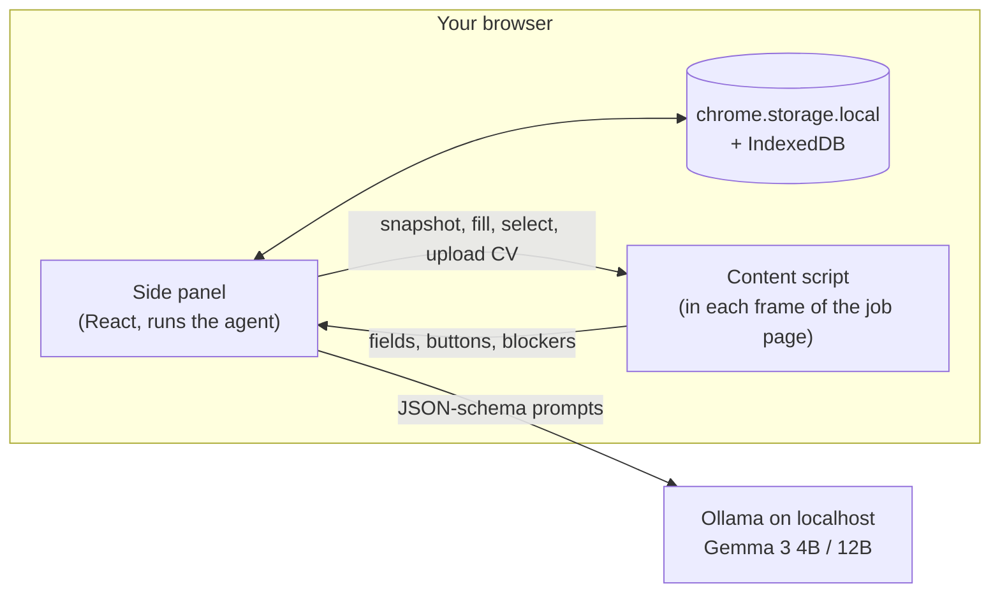

# Lazy Apply

**A Chrome extension that fills job applications with an open model running on your own laptop, asks you before anything sensitive, hands you the parts only you should do, and never clicks Submit.**

You open a job application, click the Lazy Apply icon, and press Start. It reads the form, fills your name, contact details, links and CV from your profile, drafts the "Why do you want to work here?" answer from your real experience, and lines up one-click approvals for salary, visa and diversity questions. CAPTCHAs, extra uploads and passwords become "Your turn" cards. When everything required is done, it outlines the Submit button in green and stops. You review, and you click Submit.

Everything runs locally: [Gemma 3](https://ollama.com/library/gemma3) through [Ollama](https://ollama.com), your profile in the browser's own storage, and no server of ours anywhere. Licensed Apache-2.0.


> Built for the DEV Hacktoberfest Open-Source AI Challenge (Week 3). See the [changelog](#changelog) for dates.

## Setup (three commands)

You need Chrome 116+, [Ollama](https://ollama.com/download), Node 20+ and pnpm.

```sh
ollama pull gemma3:4b-it-qat
pnpm install && pnpm build
# Chrome → chrome://extensions → Developer mode → Load unpacked → extension/.output/chrome-mv3
```

**Let the extension talk to Ollama.** Ollama blocks browser extensions by default (you'll see a 403). Allow them once:

| OS | Do this, then restart Ollama |
|---|---|
| macOS | `launchctl setenv OLLAMA_ORIGINS "chrome-extension://*"` |
| Linux | `sudo systemctl edit ollama.service`, add `Environment="OLLAMA_ORIGINS=chrome-extension://*"` under `[Service]`, then `sudo systemctl daemon-reload && sudo systemctl restart ollama` |
| Windows | Add a user environment variable `OLLAMA_ORIGINS` = `chrome-extension://*` |

The Onboarding screen checks all of this for you, shows the exact command for your OS, and has a **Quick benchmark** button so you can compare models on your own machine.

## How it works



1. **Profile, once.** Upload a CV PDF and/or LinkedIn's "Save to PDF" export. pdf.js reads the text locally, Gemma turns it into a structured profile, and code drops anything not actually in your documents (no invented jobs or bullets). You resolve conflicts between the two and review every field.
2. **Read the page, not pixels.** The content script builds a snapshot of the form from the DOM: labels (8 strategies), kinds, options, required flags, shadow DOM, cross-origin iframes (Greenhouse embeds), React-Select dropdowns, CAPTCHAs, login walls and "Apply with LinkedIn" buttons.
3. **Three stages.**
   - *Stage 1, no model:* a deterministic mapper fills name, email, phone, links, location, current company and your CV from the profile, and proposes "Decline to self-identify" for demographic questions.
   - *Stage 2, Gemma:* the remaining fields go to the model with your profile and the job description. It returns a JSON plan validated with zod. It only proposes values. Code decides the action, and caps confidence on anything that isn't stated in your profile.
   - *Stage 3, Gemma:* required essay questions are drafted one at a time, grounded in your profile and the posting, within the field's character limit. Sentences with numbers that appear in neither are removed.
4. **Policy in code decides who does what.**

| Route | When | What you see |
|---|---|---|
| Auto | From your profile, or ≥ 0.85 confidence and not sensitive | It just fills, and logs it |
| Approval | Salary, visa/work authorization, EEO, disability, veteran, criminal history, references, consent boxes, anything below 0.85, every drafted answer, anything that would overwrite your text | A card with the proposal: Approve, Edit, Regenerate, Skip, "Remember this answer" |
| Question | Required, and your profile has no answer | A card that asks you |
| Handoff | CAPTCHAs, passwords and sign-ups, non-CV uploads, video recorders, e-signatures, fields that would not stick | "Your turn" card, the field outlined on the page; it notices when you're done |

5. **Review.** A table of every field it touched and how (Auto, Approved, Edited, You did it, Skipped). Submit is outlined in green. **It never clicks it.**
6. **Multi-step forms.** When a step is done, it asks "Go to the next step?" and clicks Next/Continue only after you approve. That's the only click it ever makes, and never on anything that looks like Submit.
7. **It learns your answers, locally.** "Remember this answer" saves to your profile and to an answer memory that matches reworded questions ("Would you consider relocating?" ≈ "Are you willing to relocate?"). If [EmbeddingGemma](https://ollama.com/library/embeddinggemma) is installed (`ollama pull embeddinggemma`), it also matches questions that share no words ("When could you start?" ≈ "Earliest start date"); those matches are always pre-filled for approval, never auto-filled. Matches still go through the policy, so sensitive ones come back pre-filled for approval. The **Stats** view shows applications filled, an estimate of minutes saved, who filled what, and each model's speed, all computed on your machine.

## Privacy and safety guarantees

These are enforced in code and checked by tests, not left to the model.

- **Your data stays on your laptop.** Profile, CV, saved answers, page contents and job descriptions live only in `chrome.storage.local` and IndexedDB.
- **The model must be on this computer.** The endpoint must be `localhost` or `127.0.0.1`; anything else is rejected in Settings and again before every request. The extension's CSP only allows `connect-src 'self' http://localhost:* http://127.0.0.1:*`.
- **No analytics, telemetry, remote code, CDN fonts or error reporting.** The pdf.js worker is bundled.
- **Never submits.** Any control whose text, value, label or title says submit, apply, send, finish or confirm (or a `type=submit` that isn't plainly "Next") is refused in the page itself, even if something upstream asked. It never presses Enter in a field and never calls `form.submit()`.
- **Page text is data.** Job descriptions and labels are wrapped in `<<<PAGE_DATA … PAGE_DATA>>>` delimiters and the model is told they are not instructions. The model can't express a click or an upload at all: its plan schema only has values.
- **Never types passwords, never solves CAPTCHAs, never creates accounts, never uses "Apply with LinkedIn".**
- **Only your tab, only while the panel is open.** The agent runs inside the side panel; close it and the run is gone.
- **Site access is per site.** Nothing beyond `localhost` is granted at install. When you press Start, Chrome asks once for that job site (and any job-board iframe on it).
- **Delete all my data** in Settings wipes storage and IndexedDB.

## Choosing a model

The target machine is a 16 GB Apple Silicon laptop. Pick per slot in Settings: a **Mapping model** (reading your CV, planning fields) and a **Drafting model** (written answers), or one model for both.

| Preset | Ollama tag | `num_ctx` | Notes |
|---|---|---|---|
| Fast (default) | `gemma3:4b-it-qat` | 16384 | ~45 tokens/s on an M-series Mac; a full application takes 6–9 s of agent time |
| Quality | `gemma3:12b-it-qat` | 8192 | Better drafts, slower; needs about 9 GB of free memory |

Measured side by side on the same Mac (on battery, so slower than the AC numbers above):

| | Gemma 3 4B | Gemma 3 12B |
|---|---|---|
| Full application, agent time (Greenhouse / Lever / Ashby replicas) | 13.3 / 9.6 / 8.6 s | 32.8 / 26.0 / 21.4 s |
| Planning 6 open questions | 16 s | 41 s |
| Drafting "Why do you want to work here?" | 5.3 s, 2 sentences, 1 fact from the CV | 13.5 s, 3 sentences, 3 specific facts |
| Auto / approval / handoff decisions | identical | identical |

The decisions are identical because routing is code, not model. The drafts are where 12B earns its time, so a good setup on 16 GB is **4B as the Mapping model and 12B as the Drafting model** (turn off "Use the same model for both").

Times above were measured on AC power. On battery, the same Mac generated plain text just as fast but ran long JSON-schema outputs (profile extraction) about 10× slower, so keep the laptop plugged in for your first profile import.

Scanned CVs work too: pages with no text layer are rendered and read by Gemma's vision (about 25 s per page), then go through the same extraction and grounding. OCR can misread a word, which is what the one-time profile review is for.

Any other model Ollama has installed shows up in the list, and LM Studio or the llama.cpp server work through the OpenAI-compatible endpoint. Qwen3 and Llama 3.x are reasonable alternatives; the demo uses Gemma. Behavior and safety don't depend on the model: the policy, schemas and tests are the same for all of them.

## Development

| Command | What it does |
|---|---|
| `pnpm dev` | WXT dev mode with hot reload |
| `pnpm build` | Production build to `extension/.output/chrome-mv3` |
| `pnpm test` | Vitest unit tests (labels, mapper, policy, planner, drafter, merge, privacy) |
| `pnpm test:e2e` | Playwright with the unpacked extension against `fixtures/*.html` and a mock model (no GPU) |
| `pnpm test:e2e:ollama` | The same suite against real Ollama (needs `OLLAMA_ORIGINS`; set `LAZYAPPLY_OLLAMA_URL` if it isn't on 11434) |
| `pnpm measure` | Times real runs and counts auto / approved / handoff fields per fixture |
| `pnpm lint`, `pnpm typecheck` | ESLint and `tsc --noEmit` |

Fixtures now also cover Workable, SmartRecruiters (web components with shadow roots), Workday (button dropdowns, five steps) and a three-step form inside a shadow root.

Every e2e test also runs a **network guard**: it fails if the extension made any request other than to the configured local model. Fixtures are replicas of Greenhouse (hosted and cross-origin embed), Lever, Ashby and a generic form, each with a CV upload, another upload, an EEO block, an essay question, a fake CAPTCHA, a prompt-injection line in the job description, and a Submit button that counts clicks (it must stay at zero).

The project was built specs-first: `specs/` holds the requirements and acceptance criteria, `plan/BUILD_PLAN.md` the task list, `plan/PROGRESS.md` the log, and `plan/DECISIONS.md` every change of plan and why.

## License

[Apache-2.0](LICENSE).

## Changelog

The challenge deadline is **2026-10-25 23:59 PDT**. Anything committed after it is marked _(after deadline)_.

- **2026-10-25**
  - Workday support (button dropdowns, five-step flows) and safe step transitions; Workable, SmartRecruiters and multi-step shadow-DOM fixtures; approved "Next" for multi-step forms.
  - Semantic answer memory with EmbeddingGemma (calibrated task prefix and threshold); scanned CVs read with Gemma's vision; static landing page.
  - Answer memory (word overlap with synonyms) and a local Stats view.
  - Real Gemma 3 4B end-to-end: every P0 fixture runs to review and never submits; per-site access requested at Start.
  - Review screen with a decisions table and the Submit outline; the run survives switching views.
  - Grounded essay drafting (number check, Regenerate); handoff cards that notice when you've finished; approval and question cards with "Remember".
  - Run state machine, side panel runner, Run view; code-side policy and sensitivity classifier; deterministic mapper; stage-2 planner with grounding caps.
  - DOM-first form snapshot across frames and shadow roots; React-safe actions with read-back checks; ATS replica fixtures.
  - Profile from CV and LinkedIn PDFs with grounding, merge and conflicts; model client with loopback guard, presets, onboarding checks and benchmark; mock model and network guard.
- **2026-10-24**
  - Specs, build plan and scaffold.
